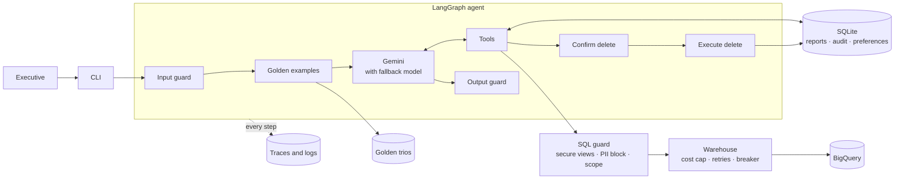

# Retail Data Analysis Chat Assistant

A chat agent that lets non-technical retail executives ask questions about sales, customers and products in plain English, discuss the answers, and get reports with action items. It queries BigQuery (`bigquery-public-data.thelook_ecommerce`) with Gemini, and it is built so that safety doesn't depend on the model behaving well.

**Documents**

| Document | Contents |
|----------|----------|
| [docs/requirements.md](docs/requirements.md) | **How each of the 8 requirements is solved**, and how it was verified |
| [docs/architecture.md](docs/architecture.md) | Production design on Google Cloud: diagrams, flows, where data lives |
| [docs/technical_design.md](docs/technical_design.md) | Why each service, model and framework was chosen; error handling; observability |
| [docs/example_run.md](docs/example_run.md) | A real recorded session |

## Architecture at a glance



The production design replaces the local parts with managed services: Cloud Run, Vertex AI, Cloud SQL with pgvector, Cloud Storage, Pub/Sub and Cloud Monitoring. See the [full diagram](docs/architecture.md#1-production-hld).

## Setup

You need Python 3.11 or newer, a Gemini API key, and a Google Cloud project. Nothing else is paid or required.

```bash
git clone https://github.com/jbernardobvdias/ai-challange.git
cd ai-challange
python3 -m venv .venv
source .venv/bin/activate
pip install -r requirements.txt
cp .env.example .env
```

1. **Gemini:** create a key at [Google AI Studio](https://aistudio.google.com/apikey) and set `GOOGLE_API_KEY` in `.env`.
2. **BigQuery:** set `GCP_PROJECT` in `.env` to your project ID, and [enable the BigQuery API](https://console.cloud.google.com/apis/library/bigquery.googleapis.com) for it. Queries **run and are billed under your project**, while the data is read from `bigquery-public-data`. They fit the free tier of 1 TB per month: a typical query here bills 20–30 MB, and each is capped at 1 GB.
3. **Sign in:** install the [gcloud CLI](https://cloud.google.com/sdk/docs/install), then run:
   ```bash
   gcloud auth application-default login
   ```
   Or use a service account: set `GOOGLE_APPLICATION_CREDENTIALS` to its key file. It needs the BigQuery Job User role.
4. **Verify:**
   ```bash
   python scripts/check_setup.py
   ```

**Gemini free tier:** when this was built, `gemini-3.8-flash` allowed only about 20 requests per day and was often overloaded, and `gemini-3.5-flash-lite` allowed 15 per minute. The agent paces its calls and falls back to `gemini-3.5-flash-lite` automatically, but each failed attempt costs time. For a faster experience, set `GEMINI_MODEL=gemini-3.5-flash-lite` in `.env`. If a model name stops being available, run `check_setup.py` to see the error, then choose another from your AI Studio account.

## Run

```bash
python -m agent.cli --user alice       # or: retail-agent --user alice
python -m agent.cli --user alice -v    # also shows the SQL and row counts
```

| Demo user | May analyse |
|-----------|-------------|
| `alice` | Categories: Jeans, Swim, Dresses |
| `bob` | Brands: Calvin Klein, Diesel, True Religion |
| `carol` | All products |

**Things to try**

| Ask | Shows |
|-----|-------|
| `What data do we have?` | Questions about the database |
| `What was our monthly revenue over the last 6 months?` | Time-based metrics |
| `Compare Jeans and Swim and explain why they perform differently` | Multi-step analysis |
| `How is customer churn trending?` | Uses an analyst's definition from the Golden Bucket |
| `Who are our top 10 customers by total spend?` | Customers shown by pseudonymous key, never by name |
| `Create a report for Q3 2026 with action items for Q4` | Report, saved to the library automatically |
| `Delete the reports we made in this conversation` | Confirmation flow: try `yes`, then `confirm`, then `undo` |
| `Show me the emails of our top customers` | PII refusal |
| `How did Outerwear do last quarter?` as `alice` | Per-user product scope |
| `I always prefer bullet points`, then `/new` and a question | User preferences |
| Edit `config/persona.yaml` while it runs | Tone changes without a restart |

Answers don't show SQL by default, because the users are non-technical. Add `-v` to see it as it runs, or use `/trace` afterwards.

**Commands:** `/trace [id]` shows every step of an answer. `/stats [all]` shows metrics. `/good` and `/bad [note]` rate an answer. `/new` starts a new conversation. `/help` lists them. `/exit` quits.

**A short excerpt** from the [full example run](docs/example_run.md):

```text
alice › Who are my top 3 customers by spend?
▸ Querying: Top 3 customers by net spend for Alice's categories (Jeans, Swim, Dresses)

 Customer Key           Net Spend  Orders  Items Purchased  Country  Acquisition Channel
 ─────────────────────────────────────────────────────────────────────────────────────
 Customer 0981c2e57a74  $1,027.99  3       5                Spain    Search
 Customer d5baf412a91d  $803.98    3       4                China    Search
 Customer 8636b741e317  $796.89    2       4                China    Search

alice › Show me the emails of our top customers
I can't share personal customer data such as names, emails, phone numbers or addresses.

alice › Delete all the reports we made in this conversation
▸ Finding the reports to delete
╭─ Delete 1 report(s)? ──────────────────────────────────────╮
│   1   Q3 2026 Performance Report: Swim & Denim  2026-11-04 │
╰────────────────────────────────────────────────────────────╯
Type 'confirm' to delete, or 'cancel' › yes
To delete, please type exactly: confirm
```

Files created at runtime: `data/app.db` (reports, audit log, preferences) and `logs/` (`traces.jsonl`, `agent.log`).

## Tests and evaluation

```bash
python -m pytest                  # unit tests: no network or credentials needed
ruff check .                      # lint
python evals/run.py               # real model and BigQuery; uses API quota
python scripts/validate_golden.py # checks the golden trios against the guard and a dry run
```

Latest evaluation on the real model and BigQuery: **16/16 passed** ([results](evals/results.json), [details](docs/requirements.md#6-quality-assurance)). It's a small set: it catches regressions rather than measuring accuracy overall. An item-by-item self-audit against the assignment's requirements is in [VERIFICATION_REPORT.md](VERIFICATION_REPORT.md).

## Framework

**LangGraph**, because the requirements map directly onto its features: an explicit graph for deterministic guard nodes, `interrupt` for the delete confirmation, and checkpointing for conversations. See [technical_design.md §5](docs/technical_design.md#5-agent-framework) for the alternatives considered and my experience with it.

## Repository layout

```
config/          schema.yaml (columns, PII flags) · users.yaml (access) · persona.yaml (tone)
data/            golden_trios/: sample Question → SQL → Report examples
docs/            requirements, architecture, technical design, example run, original plan
evals/           evaluation cases, runner and latest results
scripts/         check_setup.py · validate_golden.py
tests/           unit tests
src/agent/
  cli.py                 chat interface
  app.py                 builds the agent
  graph.py               the LangGraph graph
  prompts.py             system prompt
  llm.py                 Gemini model chain with fallback
  warehouse.py           BigQuery: cost cap, retries, cache
  bigquery_runner.py     BigQuery client provided by OpsFleet
  resilience.py          circuit breaker, per-turn budgets
  observability.py       traces, JSON logs, metrics
  trace_view.py          /trace and /stats output
  golden.py              golden trio retrieval
  persona.py             editable tone
  schema.py, users.py, config.py
  safety/                sql_guard.py · pii.py · input_guard.py
  storage/               reports_store.py · profiles.py
  tools/                 sql.py · reports.py · preferences.py
```

## Assumptions

Made without an answer from the client. Each changes the design if wrong:

| Topic | Assumption |
|-------|------------|
| "Products related to him" | Each user is entitled to a set of categories, brands or departments, and sees orders and customers only through those products |
| PII | Names, emails, street addresses, postal codes and coordinates are never accessible. Customer IDs are replaced by salted hashes before leaving BigQuery. City, state, age and gender are allowed. |
| Golden Bucket | Theoretical, so the 10 sample trios were written for this prototype and are not real analyst work |
| Churn | No order for 90 days, among customers active in the previous 180 days |
| Authentication | `--user` simulates sign-in in the prototype |
| Cloud | Google Cloud, since the data and preferred models are already there |
| Deletion | Soft delete with undo. Users delete only their own reports; no admin override. |
| Language | English |

## Known limitations

Details are in the [requirements write-up](docs/requirements.md) and [architecture.md §9](docs/architecture.md#9-security-boundaries).

- **Speed:** with an overloaded model, multi-step answers took up to about two minutes during testing. Traces show nearly all of that is model time, not BigQuery.
- **Small groups:** an aggregate can describe very few customers, and city, age and gender are quasi-identifiers when combined. Production should suppress small groups.
- **Bare names in text:** the output filter catches labelled names ("Name: Jane Doe"), not a bare name. No real name can reach the model through the data, so one could only be invented or typed by the user. Production adds Cloud DLP.
- **Prototype infrastructure:** conversations are in memory and end when the CLI exits. Circuit breakers and the cache live in one process. Logs aren't rotated, and metrics are computed but no alerts are sent.
- **Not built (design only):** implicit preference learning, the golden trio review pipeline, the persona admin console, and tools such as charts, email and web search.

## Open questions for OpsFleet

The assumptions above are my answers for now. These would change the design most:

1. How are executives actually linked to products: brand, category, department, or something else?
2. Are hashed customer keys acceptable to show, or should customers only ever appear in aggregate?
3. What minimum group size should an aggregate have before it may be shown?
4. Is there an agreed churn definition? Analysts' real definitions should replace my 90-day assumption.
5. Should every report be saved automatically, as now, or only on request?
6. How long may conversation history and traces be kept, and in which region?
7. What are the expected users, latency target and monthly budget?

## Next steps

1. Connect the real Golden Bucket, and build the analyst review pipeline.
2. Add a check that every number in a report traces back to a query result.
3. Grow the evaluation set to 50–100 cases, and run it in CI.
4. Deploy behind IAP on Cloud Run, moving state to Cloud SQL and Memorystore.
5. Add chart and email tools, using the confirm-before-acting pattern for email.
