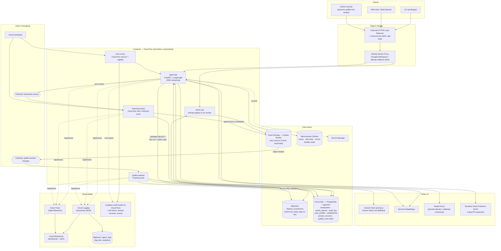
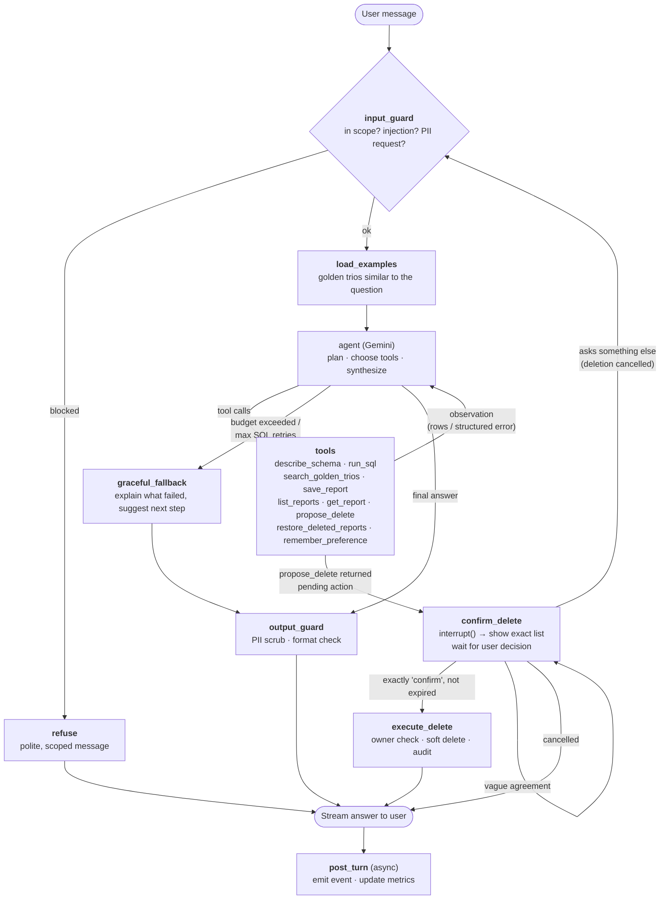
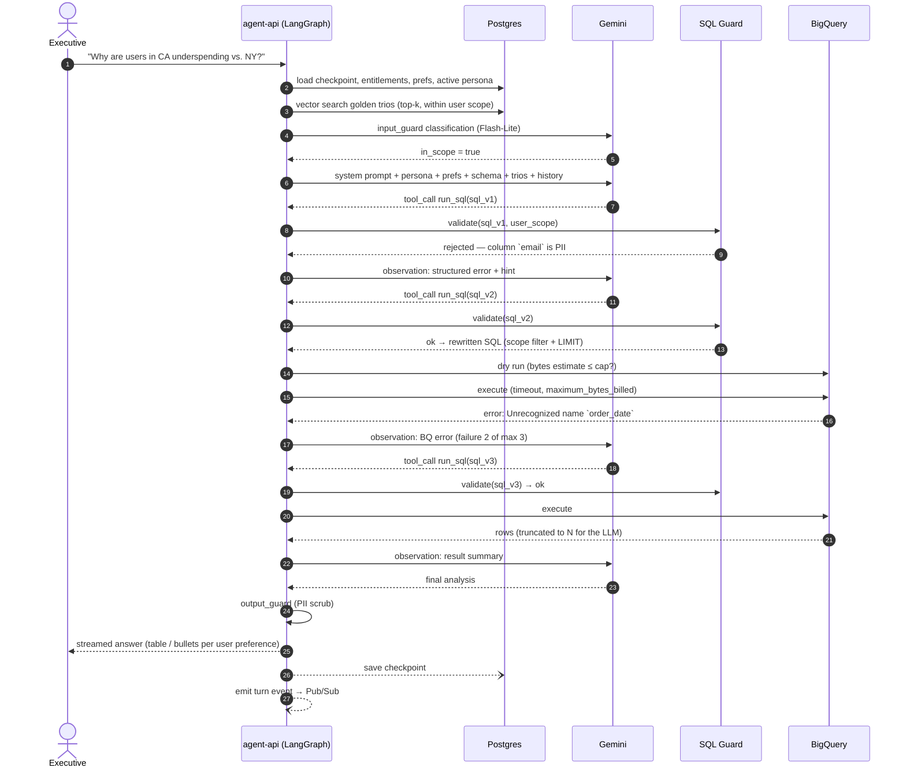
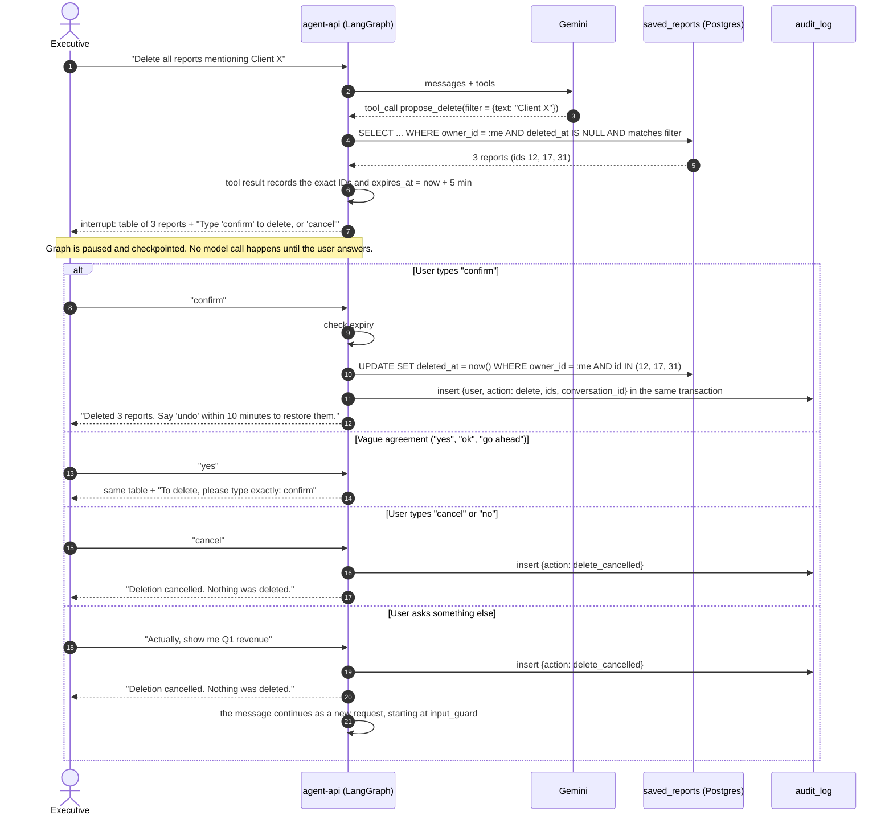
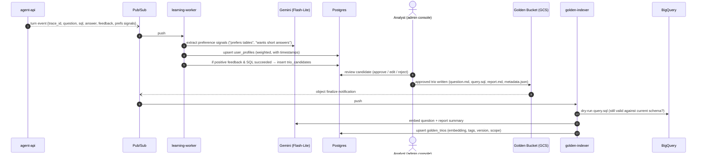
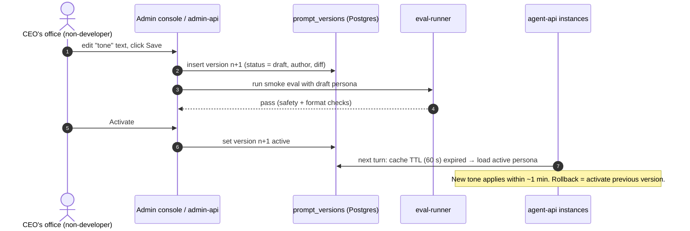
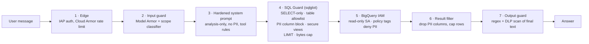
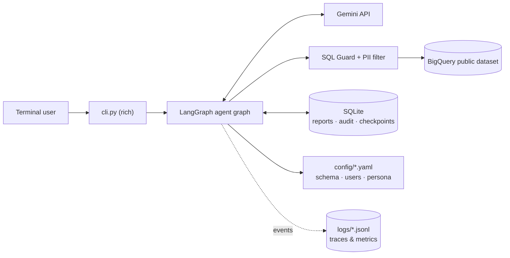

# Architecture — Retail Data Analysis Chat Assistant

This document describes the production High-Level Design (HLD) on Google Cloud, the internal agent graph, the main runtime flows, and where data lives. The reasoning behind each technology choice is in [technical_design.md](technical_design.md).

**Contents**
1. [Production HLD](#1-production-hld)
2. [Component responsibilities](#2-component-responsibilities)
3. [Agent graph (LangGraph)](#3-agent-graph-langgraph)
4. [Flow A — analysis question with SQL self-correction](#4-flow-a--analysis-question-with-sql-self-correction)
5. [Flow B — destructive operation with confirmation](#5-flow-b--destructive-operation-with-confirmation)
6. [Flow C — learning loop & Golden Bucket ingestion](#6-flow-c--learning-loop--golden-bucket-ingestion)
7. [Flow D — persona update without redeploy](#7-flow-d--persona-update-without-redeploy)
8. [Data storage & handling](#8-data-storage--handling)
9. [Security boundaries](#9-security-boundaries)
10. [Prototype vs. production](#10-prototype-vs-production)

---

## 1. Production HLD

**Reading the diagram**
- **Synchronous path** (user waiting): Client → Load Balancer/IAP → `agent-api` → Gemini / BigQuery / Postgres → streamed answer.
- **Asynchronous path** (nobody waiting): turn events → Pub/Sub → `learning-worker` (preferences, trio candidates); Golden Bucket changes → `golden-indexer` (embed + index).
- **Control plane**: Admin console → `admin-api` → prompt registry & trio review (non-developers, no redeploy).
- **Observability** is a side channel from every service; it never blocks the user path.

---

## 2. Component responsibilities

| Component | Service | Responsibility |
|-----------|---------|----------------|
| Edge | HTTPS LB + **Cloud Armor** | TLS, WAF rules, per-IP rate limiting, DDoS protection. |
| Identity | **IAP** (+ Workspace / Identity Platform) | SSO; injects a signed JWT with the user's identity. The agent never trusts a user ID from the request body. |
| `agent-api` | **Cloud Run** (Python, FastAPI, LangGraph) | Runs the agent graph per turn; stateless (state in Postgres checkpointer), scales to zero, streams via SSE. |
| LLM | **Vertex AI Gemini** Flash / Flash-Lite | Planning, SQL generation, synthesis, reports. Flash-Lite is the fallback and handles cheap classification steps. |
| Input screening | **Model Armor** + in-graph classifier | Detects prompt injection/jailbreaks and off-topic (non-analysis) requests. |
| SQL Guard | In-process library (`sqlglot`) | Deterministic validation and rewriting of every SQL statement before it reaches BigQuery (see §9). |
| Warehouse | **BigQuery** | Read-only analytics source. PII columns protected by **policy tags** (column-level security) so the agent's service account *cannot* read them. |
| Operational DB | **Cloud SQL for PostgreSQL** + **pgvector** | LangGraph checkpoints (conversation state), saved reports, audit log, user profiles/preferences, entitlements, prompt versions, golden-trio vector index. One managed, transactional store keeps the footprint small. |
| Golden Bucket | **Cloud Storage** (object versioning) | Source of truth for expert trios (`question.md`, `query.sql`, `report.md`, `metadata.json`). |
| Cache / limits | **Memorystore (Redis)** | Schema & query-result cache, per-user rate limits, shared circuit-breaker state across instances. |
| Messaging | **Pub/Sub** | Decouples the chat path from learning/indexing; retries + dead-letter topics. |
| Workers | **Cloud Run Jobs / services** | `learning-worker`, `golden-indexer`, `eval-runner`. |
| Output PII check | **Sensitive Data Protection (DLP)** | Last-line inspection of the final answer (emails, phones, names, addresses). |
| Observability | **Cloud Logging / Trace / Monitoring**, **Langfuse** | Logs, distributed traces, metrics, alerts; LLM-level traces and scoring. |
| Secrets | **Secret Manager** | API keys, DB credentials. |
| CI/CD | **Cloud Build** + **Artifact Registry** | Build, test, run eval gate, deploy new Cloud Run revision. |

---

## 3. Agent graph (LangGraph)

Each user turn executes this state graph inside `agent-api`. Nodes in **bold** are deterministic code (not LLM-controlled).

Key design points:
- **The LLM can never execute a delete.** It can only *propose* one; execution happens in a deterministic node after a human confirmation of the exact list of report IDs.
- **Every SQL statement passes through the SQL Guard inside `run_sql`**, regardless of what the LLM wrote.
- **Budgets are derived from the turn's messages**: consecutive SQL failures, LLM calls and tokens. Exceeding them routes to `graceful_fallback` instead of looping.
- New capabilities (charts, email, web search) are **added as tools** in the registry; the graph does not change.

---

## 4. Flow A — analysis question with SQL self-correction

Notes:
- Guard rejections, BigQuery errors and **empty results** are all returned to the LLM as structured observations (`{"error_type": ..., "message": ..., "hint": ...}`), never as exceptions to the user.
- For empty results (including aggregates that return only NULLs), the hint asks the model to check its filters and states the user's scope, so it can tell "no data" apart from "wrong filter" or "outside your access".
- After 3 consecutive SQL failures, or if BigQuery is unavailable, the graph routes to `graceful_fallback` without another model call for the failure itself.

---

## 5. Flow B — destructive operation with confirmation

Rules enforced in code:
- **The model has no tool that deletes.** `propose_delete` only finds what would be deleted; `execute_delete` is a plain graph node reached only after the user's exact confirmation.
- The owner comes from the signed-in user, and `owner_id = current_user` is applied in SQL by the store, so the model cannot widen it.
- Zero matches → no confirmation step, just an informative message. A request with no filter is refused rather than treated as "everything".
- Only the **exact IDs shown** are deleted. They come from the tool result stored in the checkpoint, so reports added after the proposal are unaffected, and reports already gone are reported honestly.
- Confirmation expires after 5 minutes. A confirmation that isn't exactly `confirm` never deletes.
- Soft delete + audit log → reversible and traceable. In production, a scheduled job hard-deletes after the retention window (not in the prototype).
- Confirming and cancelling use no model call, so the outcome can't be misreported by the model and costs nothing.

---

## 6. Flow C — learning loop & Golden Bucket ingestion

Learning happens **outside the request path**, so it never adds latency or cost to a user's turn. System-level changes (prompts, few-shots, schema descriptions) are validated by the `eval-runner` before activation.

---

## 7. Flow D — persona update without redeploy

The persona is only the **tone/style layer**. Safety rules, tool policies and output constraints live in the core system prompt, which is versioned in code and cannot be edited from the console.

---

## 8. Data storage & handling

| Data | Store | Written by | Read by | Retention / notes |
|------|-------|-----------|---------|-------------------|
| Transaction data (orders, items, products, users) | BigQuery | (source system) | `agent-api`, `golden-indexer` (dry-run) | Read-only. PII columns behind policy tags. |
| Conversation state (messages, tool results, pending actions) | Postgres (LangGraph checkpointer) | `agent-api` | `agent-api` | 90 days, then purged. Tool results stored **after** PII scrubbing. |
| Saved reports | Postgres `saved_reports` | `agent-api` | `agent-api` (owner only) | Soft delete; hard delete after 30 days. |
| Audit log (deletes, guard blocks) | Postgres `audit_log` → exported to BigQuery | `agent-api` | Security / ops | Append-only, 1 year. |
| User profile & preferences | Postgres `user_profiles` | `learning-worker`, explicit user commands | `agent-api` | User can view/reset ("forget my preferences"). |
| Entitlements (user → brands/categories) | Postgres `entitlements` (synced from IdP groups) | Admin / IdP sync | SQL Guard | Source of truth for data scoping. |
| Persona / prompt versions | Postgres `prompt_versions` | `admin-api` | `agent-api` (60 s cache) | All versions kept for rollback & audit. |
| Golden trios (raw) | Cloud Storage | Analysts, `learning-worker` (approved only) | `golden-indexer` | Object versioning on. |
| Golden trios (index) | Postgres + pgvector | `golden-indexer` | `agent-api` | Rebuildable from GCS at any time. |
| Cache, rate limits, breaker state | Memorystore | `agent-api` | `agent-api` | Ephemeral (TTL). |
| Logs, traces, metrics | Cloud Logging / Trace / Monitoring → BigQuery sink; Langfuse | all services | Engineers, dashboards | Logs contain **no raw PII** (scrubbed before logging). 30 days hot, 1 year in BigQuery. |

---

## 9. Security boundaries

Defense in depth — each layer works even if the one before it fails.

- **Secure views**: the SQL Guard rewrites every table reference into a subquery that exposes only non-PII columns and only rows within the user's product scope. `products` is filtered directly; `order_items`, `orders` and `users` are limited to items, orders and buyers of those products. Queries that read a whole row (`SELECT *`, `SELECT u`, `TO_JSON_STRING(u)`) therefore cannot reach personal data, because it is not in what the query can see. In production this is backed by BigQuery **row-level access policies** on authorized views per entitlement group.
- **Identity**: the user comes from the authenticated session through the run config. It is not a tool argument, so the model cannot choose whose scope applies.
- **PII**: rejected at SQL level (layer 4), unreadable at IAM level (layer 5), and filtered in results and output (layers 6–7).

**Known limitations of the prototype**
- Customer keys are pseudonymous rather than PII (assumption, see README §10). Columns named `user_id` or `customer_id` are removed from results by name, but a query can rename a key (`SELECT id AS x FROM users`), and the model is relied on not to display it. Production would need column lineage or tokenised keys.
- Small-group re-identification is not prevented: an aggregate can describe very few customers. Production would suppress groups below a minimum size.
- `orders.num_of_item` counts every item in an order, including items outside the user's scope. `order_items` is the accurate table for scoped analysis.
- The output scrubber recognises patterns (emails, phones, addresses, coordinates), not a bare person's name. Names are blocked at column level; production adds DLP.
- If the input classifier is unavailable, messages pass through to the main agent. Rules, the SQL guard and output filters do not depend on it.

---

## 10. Prototype vs. production

The prototype keeps the same graph, tools and guard logic, and swaps managed services for local equivalents so it runs on any machine.

| Concern | Production | Prototype |
|---------|-----------|-----------|
| Interface | Web / Slack via LB + IAP | CLI (`rich`), user chosen with `--user` |
| Identity & entitlements | IAP JWT + Postgres `entitlements` | `config/users.yaml` |
| Compute | Cloud Run | Local Python process |
| LLM | Vertex AI Gemini | Gemini API (AI Studio key), primary + fallback model |
| Input screening | Model Armor + classifier | Gemini classifier + rules |
| PII column protection | Policy tags + SQL Guard | SQL Guard + result filter |
| Output PII check | DLP | Regex scrubber |
| Conversation state | Postgres checkpointer | In-memory checkpointer (a conversation ends when the CLI exits; saved reports remain) |
| Saved reports, audit log | Postgres | SQLite (`data/app.db`, created on first run) |
| Golden trios | GCS + pgvector | `data/golden_trios/*.json` + in-memory similarity, cached embeddings |
| Persona | `prompt_versions` + admin console | `config/persona.yaml`, re-read on every model call |
| User preferences | `user_profiles` | `user_preferences` table in `data/app.db` (explicit preferences only) |
| Observability | Cloud Logging/Trace/Monitoring + Langfuse | `logs/traces.jsonl` and JSON `logs/agent.log`, `/trace`, `/stats`, `/good`, `/bad` CLI commands |

